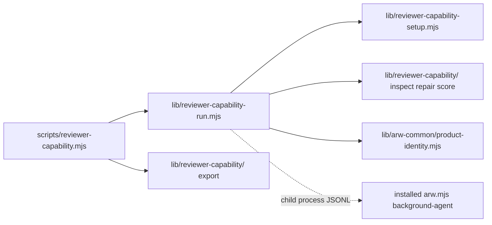

# Reviewer 能力验证的单实例运行与导出

## Problem Statement

Reviewer 能力验证的一个实例今天要由 Main Agent 按 `$reviewer-capability` Skill 的 `Run` 第 2 到 4 步手工完成: `setup` 搭场景, 经 `arw background-agent` 启动 Reviewer, 反复 `wait_agent`, 收到程序暂停通知时发 "继续", 自己计 60 分钟时限并在超时时中断, 完成后保存 `list_agents` 结果为 `agent.json`, 再依次 `inspect`, `repair`, `score`. 一个实例要十来次工具调用, 每一步的分支 (暂停, 超时, 没有结论就退出, 禁止来源命中) 都靠 Main 读规则判断, 容易漏步; 多模型 benchmark 一次要跑上百个实例, 这样做不可行.

维护者已决定: ARW 是 Reviewer benchmark 的唯一来源, 题目 (场景, 夹具, 答案键, 盲裁 brief), 跑分与计分代码都只在 ARW. 外部工程 (多模型 benchmark 的结果汇总与发布页, 本机推理服务的测量) 不再保存副本, 而是按一个 ARW 提交引用它来跑分. 它们因此需要两样 ARW 目前没有的东西: 一个能一次跑完单个实例的命令, 以及每个实例一条带出处的机器可读记录 (哪个 ARW 提交, 哪棵夹具树, 实际跑的是哪个已安装运行时), 使结果以后仍能按记下的版本解释. 当前开发长期规格却写着该 Module "不拥有多模型 benchmark 的记录与运行层内容 (... 速度与导出 ...)", 启动 Reviewer 由 Skill 完成, 与这个决定冲突.

## Solution

`scripts/reviewer-capability.mjs` 增加两个子命令:

- `run`: 单实例端到端. 依次记录出处, `setup`, 经已安装 ARW 的 `background-agent` 机器入口 `spawn_agent`, 等待 (暂停通知后自动继续, 60 分钟时限), 保存 `agent.json`, `inspect`, `repair`, `score`, 写出实例记录. 盲裁仍走现有 `pool` 流程, 不进 `run`.
- `export`: 读取一组实例目录, 每个实例输出一条记录: ARW 提交, 夹具树 SHA, 已安装运行时版本, 场景, 设置, 用时与 token, 开始与完成时刻, 作废原因和定稿分数. 字段名沿用外部 benchmark v1 结果文件 `instances` 的字段名, 使已有的读取方只需小改.

责任边界:

| 内容 | 归属 |
| --- | --- |
| 场景, 答案键, 盲裁 brief, 计分, 盲裁组池与裁决库, 格内统计 `summary` | ARW (已有) |
| 单实例的运行 (`run`) 与实例记录导出 (`export`) | ARW (本次新增) |
| 多实例矩阵与运行计划, 成本, 依赖模型配置表的统计 (配置编号, 一致性行, 补充行, 敏感性行, 阶段, pooled 格, 由有效性判据派生的计数), 结果发布 | 外部消费方, 不进 ARW |

矩阵由消费方用简单脚本或手动循环调用 `run`, 并把所用 ARW 提交作为结果的出处元数据保存. 改 ARW 的场景或计分只影响之后的跑分; 已有结果按记下的提交解释.

## Implementation Decisions

### Run flow

`node scripts/reviewer-capability.mjs run <scenario-directory> <new-instance-directory> --settings <json>`. `--settings` 是 JSON 对象文本, 原样作为 `spawn_agent` 输入的 `settings` (例如 `{"model":"gpt-6-luna","modelProvider":"openai","reasoningEffort":"xhigh","serviceTier":"default"}`); 不是 JSON 对象时是用法错误 (退出 `2`), 内容由机器入口校验 (Reviewer 输入的 `settings` 键由机器入口宿主 `lib/arw-background-agent-host.mjs` 读取, 字段由 `lib/reviewer-runtime/reviewer-runtime.mjs` 校验, 现有 Skill 以同一键启动). 实例目录与 `setup` 的要求相同: 必须是新路径. 把实例放在调用方会话临时目录内是 Skill 对调用方的约定, `run` 不另行检查; 恢复目录 (`setup` 返回的 `stateDirectory`) 不合机器入口要求时由 `spawn_agent` 拒绝, 按下文机器入口失败处理. "检出" 指 `scripts/reviewer-capability.mjs` 所在的源码仓库根 (与 `setup` 定位检出的方式相同), 与调用时的工作目录无关. `run` 按下列阶段推进, 每个阶段只在前一阶段成功后开始:

1. 出处: 读取已安装 ARW 的 `manifest.json` 和检出的 Git 事实 (见 Provenance 节). 没有安装 (`manifest.json` 不存在) 时返回 `blocked`; Git 子进程或安装文件读取失败时返回 `failed`, `stage` 为 `provenance-read`. 两者都不创建实例目录.
2. 搭建: 调用现有 `setup`, 其 `blocked` 与 `failed` 原样返回 (现有合同保证失败时删除目标).
3. 启动: 以当前 Node 运行 `<安装目录>/arw.mjs background-agent` 子进程 (不带 `--wait`), 经其标准输入输出按 JSONL 收发, 发送 `spawn_agent`, 输入是 `setup` 返回的 `input` 加 `settings`. 回执 `ok: true` 的时刻是实例起点, 时限为起点后 60 分钟. 然后用回执的 `runId` 调 `list_agents` 取得首个 `cursor`.
4. 等待: 反复 `wait_agent {runId, cursor, timeout_ms}`, `timeout_ms` 取剩余时间与 `3600000` 的较小值, 每次响应后改用新的 `cursor`. 响应的通知中出现来源为 `provider-program` 且正文以 `The Reviewer runtime paused this same task after ` 开头的消息时, 对每个新消息编号发一次 `send_message {runId, message: "继续"}` 后继续等待 (按消息编号去重, 重复观察不重复继续). 没有更新而等待超时时以原 `cursor` 继续. `completion` 非空时结束等待. 运行环境已退出而 `completion` 仍为 `null` 时结束等待, 实例作废 (`no-completion`). 剩余时间不足 10 秒 (机器入口 `timeout_ms` 的下限) 而 `completion` 仍为 `null` 时, 实例作废 (`timeout`): 取最近一次 `wait_agent` 或 `list_agents` 响应 `result.turnId` 中最后一个非空值发 `interrupt_agent`; 从未观察到非空 `turnId` 时不发; `interrupt_agent` 返回 `ok: false` 时仍作废 `timeout`, 把错误码写入 `notes` 并继续保存, 因为实例已超过时限, 中断失败不改变它不可计分的事实, Main 可按 `reviewer-launch` Skill 手工中断. (`wait_agent` 与 `list_agents` 的 Reviewer 结果字段 `turnId`, `state`, `notifications`, `cursor`, `completion` 由管理进程的观察结果给出, `measurement` 由机器入口宿主附加, 见 `lib/background-agent/manager.mjs` 与 `lib/arw-background-agent-host.mjs`.)
5. 保存: 调 `list_agents {runId}`, 把 `{status: "succeeded", result}` (`result` 为该响应的 `result`) 写成 `<instance>/agent.json`, 与 `score` 和 `inspect` 现有的读取形状一致. 随后关闭子进程标准输入; 机器入口写完全部响应后自行退出, 管理进程和后台运行不受影响.
6. 检查: 作废的实例跳过本步和后续计分. 否则运行现有 `inspect`: `blocked` 时实例作废 (`inspect-blocked`), `flags` 非空时实例作废 (`inspect-flags`, `notes` 只写原因码, 条目数和首条的 `kind`, 不写 `match` 或 `text`, 因为它们可能含本机绝对路径或答案键片段, 而记录会公开导出; 完整条目由调用方对实例重跑 `inspect` 查看); `failed` 原样返回.
7. 计分: 对 `completion.reportPath` 运行现有 `repair`, 输出 `<instance>/report.repaired<原扩展名>`; 修复记录有修改时对副本计分并传 `--repair`, 否则对原报告计分并传 `--no-repair`. 现有 `score` 合同规定模型失败的实例带修复记录时返回 `blocked`. 这在多模型测量中会出现: `repair` 把任何以 `- ` 或编号开头的行当作要点并删去其前的前言 (`lib/reviewer-capability/repair.mjs`, `lib/reviewer-capability/evidence.mjs` 的 `FINDING_START`), 而 Spec Readiness 的读取器只认 `- CHECK, gap|uncertain: ...` 形式的行, 没有这样的行就是模型失败 (`lib/reviewer-capability/reports.mjs`); 有前言而要点格式全不合的报告因此既有修改记录又没有可评分内容. 所以带 `--repair` 的计分返回 `blocked` 时, 改对原报告传 `--no-repair` 重试一次: 结果含 `scores.modelFailure` 时采用它, 否则返回第一次的 `blocked`. `repair` 不传 `--spill`: 溢出文件 (Harness 把大输出保存成的文件) 不在 `agent.json` 中, `run` 没有可靠来源; 代价是引用溢出文件行号的定位段不被转换而在所属用例内失分, 需要时 Main 在定稿时对 `run.json` 的 `report` 手工重跑带 `--spill` 的 `repair` 与 `score`. `score` 带 `--agent <instance>/agent.json` 与 `--instance <实例目录名>`, 不带裁决库. 完整输出写成 `<instance>/score.json`, 其中 `candidates` 另写成 `<instance>/candidates.json` 供 `pool build` 使用. `completion` 为 `ready` 或 `incomplete` 都计分, 报告没有可评分内容时 `score` 自己给出模型失败 0 分. `repair` 或 `score` 的 `blocked` 与 `failed` 原样返回.
8. 记录: 写 `<instance>/run.json` (见 Instance record 节), 返回 `{status: "succeeded", record}`, `record` 即 `run.json` 的内容.

结果:

| 情形 | 返回 | 已写入 | 调用方下一步 |
| --- | --- | --- | --- |
| 正常完成 (含模型失败) | `succeeded`, `validity.valid` 为真 | `agent.json`, 修复副本与记录, `score.json`, `candidates.json`, `run.json` | 按 Skill 盲裁, 定稿后覆盖 `score.json` |
| 超时, 没有结论就退出, `inspect` 的 `blocked` 或标记 | `succeeded`, `validity.status` 为 `void`, `notes` 写原因 | `agent.json`, `run.json` (检查不通过时没有计分文件) | 用新实例路径重跑 |
| 未安装 ARW, 场景或目标不合法 | `blocked` | 无 (`setup` 自己的合同) | 修正输入 |
| 读取出处失败 (`provenance-read`), 机器入口不能启动, 提前退出或除超时中断外任一请求返回 `ok: false` (`agent-control`), 写实例文件失败 (`instance-write`) | `failed` | 失败之前各阶段的文件, 没有 `run.json` | 按诊断排除原因后用新实例路径重跑 |
| `setup`, `inspect` 的 `failed`, `repair` 或 `score` 的 `blocked` 或 `failed` (上述模型失败回退除外) | 原样返回 | 失败之前各阶段的文件, 没有 `run.json` | 按诊断修正输入或排除原因后用新实例路径重跑 |

新增的三个 `stage` 都来自外部进程 (Git, 机器入口) 或文件系统; 机器入口拒绝请求的原因 (含设置不合法) 由入口判定, `run` 不解析错误码去区分输入问题与环境故障, 所以三者统一记为 `failed`, 开发长期规格中 `failed` 的适用范围随之列入它们. 作废是 Reviewer 实例的结果, 不是 `run` 自身的失败, 所以返回 `succeeded`, 由 `validity` 区分, 使调用方循环能把作废实例照样记入出处并按 Skill 重跑. 机器入口请求失败时 (`stage` 为 `agent-control`, 诊断给出 `runId` 与原始错误码和消息; 设置被拒, 容量不足, 调用方身份缺失与入口进程故障都归此类, 不再细分, 因为调用方的处理相同: 读诊断, 排除原因, 换新实例重跑), 后台运行可能仍在进行, `run` 不自动中断或重发, 因为请求结果不确定时盲目重发可能产生第二个运行; Main 按 `reviewer-launch` Skill 的机器操作说明观察或中断它. 同一格因同一原因连续作废的处理 (连续 2 次停止, 连续 3 次没有结论不记分) 仍由调用方按 Skill 判断, `run` 只负责一个实例.

`inspect` 标记的条目今天可由 Main 复核后保留. `run` 不提供这个例外: 它总是把 `flags` 非空的实例作废, 需要保留时 Main 仍可对该实例手工运行 `score`, 但 `export` 记录的仍是作废. 这样 `run` 和 `export` 不需要接受人工判定的输入, 代价是极少数误报实例要重跑一次.

### Provenance

`run` 在搭建前记录出处:

- `arw.commit`: 检出的 `git rev-parse HEAD`.
- `arw.treeDirty`: `git status --porcelain --untracked-files=no` 是否非空, 即已跟踪文件是否有未提交改动. 场景内容 (`setup` 复制的角色指令, 根 `AGENTS.md`) 取自工作树, 所以有改动时仅凭提交号不能复现.
- `arw.fixtureTree`: `git rev-parse HEAD:tests/fixtures/reviewer-capability`, 外部引用方用它核对引用的提交确实带这份夹具.
- `runtime.arwVersion`: 已安装 `manifest.json` 的 `arwVersion`.
- `runtime.matchesCheckout`: `manifest.json` 的 `managedFiles` 中每个路径在安装目录与检出工作树中的字节都相同时为真.

安装目录是当前用户主目录下固定的 `.agent-repository-workflow` (产品身份模块的 `INSTALLATION_DIRECTORY_NAME`), 不按引用的提交重装. Reviewer 实际由用户级后台管理进程运行, 而管理进程运行的是安装目录中的代码, 所以运行时版本必须记已安装的那一份. 从检出克隆安装的版本号形如 `0.5.4-pre`, 不含提交, 单凭版本号无法判断是否与检出一致; 安装载荷中每个文件的安装路径与源码路径相同, 逐字节比较即可给出确定的判断. 不一致时照样运行, 记录同时含检出的 `arw.commit` 与已安装的 `runtime.arwVersion`, `runtime.matchesCheckout` 为假, 并向 `stderr` 写一条诊断, 由读取方决定能否与其他结果比较 (需要严格同配置比较时, 测量期间不升级安装).

### Instance record

`run.json` 含下表中除 `pauses` 与 `scoring` 以外的全部字段 (这两项来自盲裁后定稿的 `score.json`, 只由 `export` 合成), 另有两个只供本机重新计分的字段 `report` (被计分的报告路径: 修复副本, 或无修改与模型失败回退时的原报告) 与 `repair` (修复记录的 `changes` 非空且按 `--repair` 计分时为该记录路径, 其余情形为 `null`; 无修改时 `repair` 操作照样写出的记录留在实例目录中, 不被引用), `export` 不输出它们. 已有字段名取自外部 benchmark v1 结果文件的 `instances`, 新增的出处字段沿用本节名称. 时间为 ISO 8601 UTC, 时长为秒, `null` 表示未知或不适用, 不是 0.

| 字段 | 内容 | 来源 |
| --- | --- | --- |
| `id` | 实例目录名, 与 `score --instance` 相同 | 实例目录 |
| `scenario` | `<role>/<scenario>` | 场景目录的末两段 |
| `arw` | `{commit, treeDirty, fixtureTree}` | Provenance 节 |
| `runtime` | `{arwVersion, matchesCheckout}` | Provenance 节 |
| `settings` | `--settings` 给出的对象 | 输入 |
| `startedAt`, `completedAt` | 任务开始与结束时刻 | `agent.json` 中 `measurement` 的 `startedAt` 与 `finishedAt` (毫秒时间戳) |
| `time` | `{durationSeconds, durationEstimated, wallClockSeconds, timeLimitSeconds}` | `measurement.workDuration` 的 `durationMs` 与 `estimated`, `measurement.wallClockMs`, 时限固定 `3600` |
| `tokens` | `{uncachedInput, cachedInput, output}` | `measurement.usage` 的 `inputTokens - cachedInputTokens`, `cachedInputTokens`, `outputTokens`, 任一分量未知则为 `null` |
| `validity` | `{valid, status, notes}`, `status` 为 `valid` 或 `void`, 作废时 `notes` 以原因码 `timeout`, `no-completion`, `inspect-blocked`, `inspect-flags` 开头 | Run flow 节 |
| `pauses` | `{known, count}` (只在 `export` 中) | 定稿 `score.json` 的 `pauseCount`; 作废实例为 `{known: false, count: null}` |
| `scoring` | `{status, score, rawScore, scoreBeforePenalty, formatPenalty, overallDeduction, repairs}` (只在 `export` 中) | 定稿 `score.json` 的 `scores`: `status` 有 `modelFailure` 时为 `modelFailure`, 否则为 `final`; `score` 取 `final`, `formatPenalty` 取 `f`, `repairs` 取 `rRepairable`; 作废实例整项为 `null` |

v1 的其他实例字段 (配置编号与臂, 选取与阶段, 速度, 工具调用与压缩次数, 费用, 并行时段, 子线程明细, 旧计分版本分数) 依赖消费方的配置表或已不存在的运行层, 不输出. 实例记录不含本机绝对路径或会话身份 (`run.json` 的 `report` 与 `repair` 除外, 它们不导出), 因为导出结果会进入公开发布.

### Export

`node scripts/reviewer-capability.mjs export <instance-directory> ...` 只读, 返回 `{status: "succeeded", schemaVersion: 1, instances}`, `instances` 按给出顺序. `schemaVersion` 在字段改名或删除时加 1, 读取方据此识别格式. 每个实例读取 `run.json`; 有效实例另读 `score.json`, 只接受定稿输出 (`status` 为 `succeeded`, `candidates` 为空, `provisional` 为 `null`), 与 `summary` 的定稿判据相同, 因为暂计分不能进入发布. 返回 `blocked` 且不输出任何记录: 没有给出实例; 实例 `id` 重复; `run.json` 缺失或不是 JSON; 有效实例的 `score.json` 缺失, 不是 JSON 或未定稿. 其他读取错误返回 `failed`, `stage` 为 `report-read`. 部分输出没有用处, 所以任一实例不合格时整体不输出.

### Skill

`$reviewer-capability` Skill 的 `Run` 第 2 到 4 步改为调用 `run`: 给出命令和 `--settings` 示例, 说明实例路径要求, 结果表各情形的下一步, 以及 Codex 沙盒中须在沙盒外运行 (与 `reviewer-launch` Skill 对 `arw background-agent` 的说明相同). 原第 3 步中 Main 手工发 "继续", 计时, 中断与保存 `agent.json` 的说明, 以及原第 4 步的 `repair` 与 `score` 命令删除, 由 `run` 承担; 模型失败, 运行故障重跑与连续作废停止的判定保留为调用方规则. 第 7 步定稿后的 `score` 输出写回 `<instance>/score.json` (用 `run.json` 的 `report` 与 `repair` 重新计分), 第 9 步说明可用 `export` 取得实例记录. 其余步骤不变.

## Testing Decisions

`run` 的确定性测试用一个假的已安装运行时: 临时主目录 (`HOME` 与 `USERPROFILE`) 下放 `.agent-repository-workflow/manifest.json` 和一个按 JSONL 应答的假 `arw.mjs`. 假入口把收到的每个请求追加到日志文件, 按预设脚本应答 `spawn_agent`, `list_agents`, `wait_agent`, `send_message` 和 `interrupt_agent`, 在应答完成时把预设报告写到请求中的 `reportPath`, 并让 `list_agents` 结果指向测试准备的原生记录. 测试以子进程运行 `scripts/reviewer-capability.mjs run`, 观察退出码, 标准输出, 请求日志和实例目录中的文件. 这样不为测试在生产代码中增加注入接缝, 代价是每个案例启动两个进程:

- 正常完成且中途有一次暂停通知 (测试子进程的工作目录不是检出, 以证明出处取自脚本所在检出): 日志中对该通知恰好有一个 `send_message` "继续"; 实例中有 `agent.json`, `score.json`, `candidates.json` 和 `run.json`, 记录的 `arw.commit` 等于检出 HEAD, `validity.valid` 为真; 假 manifest 中一个文件与检出字节不同, 记录 `runtime.matchesCheckout` 为假且 `stderr` 有诊断, 运行照常完成. 它防止暂停后卡住, 重复继续, 以及版本不一致时拒绝运行.
- 运行环境退出而 `completion` 为 `null`, 且 `list_agents` 结果没有 `measurement`: 记录作废 `no-completion`, 没有 `score.json`, `startedAt`, `time.durationSeconds` 与 `tokens` 各分量为 `null`; 防止把没有结论的实例计分, 以及把未知用时写成 0.
- 原生记录读取了答案键: `inspect` 产生 `flags`, 记录作废 `inspect-flags`, 没有 `score.json`, `run.json` 中没有本机绝对路径 (`report` 与 `repair` 以外) 和答案键片段; 防止计分违规实例和把隐私或答案写进公开记录. `inspect-blocked` 与它走同一作废路径, 不另测.
- Spec Readiness 场景, `completion` 为 `incomplete`, `.txt` 报告有前言和一个不合格式的 `- ` 要点: `repair` 产生修改记录, 带 `--repair` 的计分返回 `blocked`, 回退后返回 `succeeded`, `validity.valid` 为真, `run.json` 的 `report` 为原报告且 `repair` 为 `null`, `score.json` 含 `modelFailure` 且分数为 0; 防止把有结论但没有可评分内容的实例当作运行失败或作废. 没有任何要点的报告是它的特例 (无修改, 直接按 `--no-repair` 计分), 不另测. `incomplete` 与 `ready` 走同一计分路径, 不另测 `ready` 的模型失败.
- 假入口对 `spawn_agent` 返回 `ok: false`: 返回 `failed`, `stage` 为 `agent-control`, 没有 `run.json`; 防止把启动失败当作作废实例记入出处.
- 实例目录已存在: 返回 `setup` 的 `blocked`, 请求日志为空; 防止在搭建失败时仍启动 Reviewer.

未安装 (临时主目录中没有 `manifest.json`) 返回 `blocked` 且不创建实例目录, `--settings` 不是 JSON 对象时退出 `2`, 这两项不需要假入口. 60 分钟超时分支不做自动测试: 观察它要么真实等待 60 分钟, 要么在生产代码中加时钟接缝, 后者违反本仓库不为测试改生产代码的约定; 它只是剩余时间与 10 秒的比较加一个 `interrupt_agent` 请求, 由审查覆盖. `repair` 与 `score` 的失败原样返回, 由它们现有的测试覆盖; 写实例文件失败 (`instance-write`) 与出处读取失败 (`provenance-read`) 只在磁盘或 Git 故障时发生, 不制造.

`export` 的测试直接写 `run.json` 与 `score.json`, 在进程内调用: 有效实例的字段映射 (含模型失败的 `status`), 作废实例的 `scoring` 为 `null` 与 `pauses.known` 为假, 输出不含 `report` 与 `repair`; 未定稿, 缺少 `run.json`, 重复 `id` 都返回 `blocked` 且没有 `instances`. 其他读取错误 (`failed`) 只在磁盘故障时发生, 不制造.

真实端到端由实施时的一次真实运行证明: 用 Codex `gpt-6-luna` `xhigh` 跑任一场景的一个实例, 再 `export` 它. 它证明真实机器入口的请求与响应形状与假入口一致, 这是确定性测试无法证明的部分.

## Out of Scope

- 多实例矩阵, 运行计划, 成本, 依赖模型配置表的统计, 结果发布.
- 盲裁 (`pool` 各动作) 和定稿重算不进 `run`.
- 不按引用的提交重装运行时, 不阻止运行时与检出不一致的运行.
- 不改变 `setup`, `inspect`, `repair`, `score` 的现有合同.
- 不卸载后台运行 (`unload_agent`): 空闲运行由管理进程按容量规则回收.

## Module Design

### Modules

`Reviewer Capability Module` 的责任扩大为拥有单实例的运行与导出: `run` 由新的顶层连接文件 `lib/reviewer-capability-run.mjs` 实现, 与 `setup`, `pool view` 一样位于 `lib/` 第一层, 因为它连接 `setup` (本身是顶层连接实现), 产品身份 (`lib/arw-common/product-identity.mjs` 的安装目录名) 和 `lib/reviewer-capability/` 的 `inspect`, `repair`, `score`. `export` 只读实例文件, 是 `lib/reviewer-capability/` 内的操作. 该 Module 仍不拥有成本, 依赖模型配置表的统计, 多实例矩阵和发布, 不启动裁判, 不授权审核, 提交或发布. 它仍不进入 Workflow Distribution 或 release 安装包.

### Interfaces

- `run {scenario, target, settings}`: 结果与错误见 Run flow 节的结果表; `succeeded` 载荷为 `{record}`. 新增 `stage`, 都对应 `failed`: `provenance-read` (Git 子进程失败, 已安装 `manifest.json` 存在但读取失败, 或比较时读取文件失败), `agent-control` (机器入口不能启动, 提前退出, 或除超时中断外任一请求返回 `ok: false`), `instance-write` (写 `agent.json`, `score.json`, `candidates.json` 或 `run.json` 失败); 其余 `stage` 来自所调用的现有操作.
- `export {instances}`: 见 Export 节.
- 入口 `scripts/reviewer-capability.mjs` 增加 `run <scenario-directory> <new-instance-directory> --settings <json>` 与 `export <instance-directory> ...`, 退出值映射不变.

### Seams and Adapters

没有新 Seam. `run` 与已安装运行时之间的边界是机器入口子进程及其 JSONL 合同, 测试在该边界放一个假入口, 不在生产代码中注入. 已安装文件与检出文件的比较直接使用 `node:fs`, 理由与现有夹具读取相同: 路径来自本机安装清单和受信任检出, 不是对用户仓库的受限访问.

### Dependencies and Data Flow

`run` 不导入 `lib/reviewer-runtime/` 或 `lib/background-agent/`, 只经子进程调用已安装的机器入口, 所以 Module 的单向依赖不变. 数据流: 检出与安装清单得到出处, 夹具经 `setup` 得到场景仓库与 `spawn_agent` 输入, 机器入口的响应得到 `agent.json`, `agent.json` 与报告经 `inspect`, `repair`, `score` 得到 `score.json` 与候选, 出处, `agent.json` 的 `measurement` 与有效性合成 `run.json`; 盲裁后定稿的 `score.json` 与 `run.json` 经 `export` 得到实例记录.

### Module Design Rationale

单实例运行放进 ARW, 是因为 ARW 已是题目与计分的唯一来源, 而跑一个实例的步骤 (启动设置, 暂停继续, 时限, 记录保存, 检查与计分的先后) 决定分数能否比较; 让外部工程各自实现这些步骤, 就会像以前的冻结副本那样随 ARW 变化而漂移. 成本, 依赖模型配置表的统计和发布不放进 ARW, 因为它们依赖模型清单, 价目和发布格式, 能力验证不应依赖任何模型工程的配置. 矩阵循环不进 ARW, 因为它只是对 `run` 的重复调用加消费方自己的配置表.

`run` 调用已安装的机器入口而不是导入检出中的后台 Agent 实现, 因为 Reviewer 实际由用户级管理进程运行, 管理进程运行的是安装目录中的代码; 从检出导入既不改变实际运行时, 又会让该 Module 依赖 `lib/background-agent/`. 被拒绝的替代是按引用的提交临时安装运行时: 安装会改写用户的全局安装并停掉共用管理进程, 代价远高于记录两个版本. `export` 沿用 v1 字段名而不另起格式, 使读取方只需小改; 只输出 ARW 能亲自观察的字段, 因为配置号, 费用等由消费方的配置表决定.

## ADR Evaluation

- 权威来源: Reviewer benchmark 的单实例运行与实例记录的权威从 "外部工程各自的运行层" 变为本 Module. 这是源码专用维护工具内的责任边界, 理由写入开发长期规格的 Module Design Rationale 节; 它不改变授权主体, 信任根或分发边界, 也不进入安装包.
- 持久状态: `run.json`, `agent.json`, `score.json`, `candidates.json` 与修复副本都在调用方给出的会话临时实例目录中, 不是 ARW 的持久状态. `export` 的输出是供外部读取的数据格式, 由 `schemaVersion` 标识版本, 外部消费方自行保存; ARW 不读取导出结果.
- 恢复合同: `run` 不做恢复, 失败或作废都用新实例路径重跑; 机器入口请求失败时不自动重发, 沿用 `reviewer-launch` Skill 已有的人工观察与中断. 不新增恢复机制.

以上都容易撤销 (删除两个源码专用子命令即可), 不需要新的 ADR.
