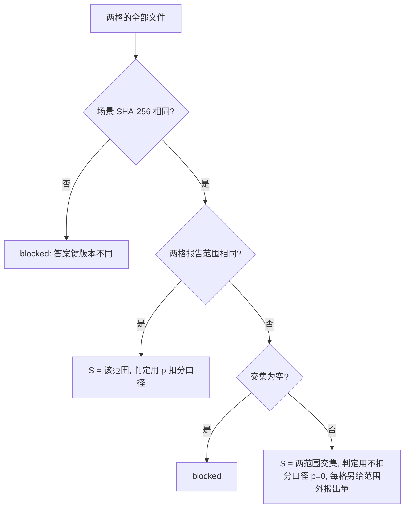

# Reviewer 能力验证按报告范围计分

## Problem Statement

Reviewer 能力验证用固定题目给 Reviewer 打分, 以 A/B 比较改动前后的 Reviewer 规则. 答案键 `expected.json` 把每道问题题都当作 "应当报告", 没有严重度. 当被测改动本身就是改变 Reviewer 报告什么 (例如候选规则规定只报高级和中级问题, 低级问题不写入报告), 候选组按设计不报的低级问题题仍计入分母, 候选组被系统性压低; 而对照组照它自己的规则报出这些题仍然得分. 两组按不同标准答题, 却按同一份 "全部都该报" 的答案键计分, A/B 的差值因此混入了规则本身的设计差异, 不再只衡量检出能力.

现有规则还把这个状态固定下来: `$reviewer-capability` Skill 要求 A/B 两组使用同一版答案键, "也不在同一改动里顺手修场景或答案键". 这条规则防止改题凑分, 但也让 "规则改了范围而题不改" 成为默认.

另外三个缺口:

- 改答案键的任何字节都改变场景身份 (场景 SHA-256), 格式罚基线登记随即拦下全部计分, 而规则要求重测基线 (每个计分单元 5 次模型运行), 即使 Reviewer 看到的文件一字未变.
- `summary --compare` 不核对两格是否用同一版答案键计分, 新旧口径的分数可以混比而不报错.
- 去掉低级题后, 有的场景某一级题量过少 (例如 `code-standards` 只有 4 道高级题), 不足以衡量 "该级检出没有下降".

## Solution

1. 答案键的每道问题题带严重度 `severity` (`high`, `medium`, `low`), 定义见严重度节. 严重度由不看任何测量结果的独立评级给出, 结果双向生效.
2. `score` 不改变现有分数, 只在输出中另给每一级的得分组成和场景 SHA-256. 报告范围与范围外扣分在 `summary` 处理: 每格声明它的 Reviewer 规则要求报告的级别 (报告范围), `summary` 按范围重算每个实例的 `final`.
3. 范围外的问题题: 不进分母, 报出时按普通误报的一定比例扣分 (该题 k 乘得分再乘系数, 系数默认 0.25, 可调).
4. `summary --compare` 要求两格同一场景 SHA-256, 并按两格的范围是否相同选择判定口径 (见 Compare 节).
5. 场景身份并入 `handoff.md`; 只改答案键而 Reviewer 可见文件不变时, 格式罚基线可以只重新登记场景 SHA-256, 不必重测.
6. 规则: 改 Reviewer 报告范围的 issue 必须在同一 issue 中更新答案键严重度, 声明两格的范围, 并给出题量表; Skill 中与此冲突的 "不在同一改动里修答案键" 改为只禁止其他夹带.
7. `code-standards` 补高级题到 5 道 (见补题节).

## User Stories

1. 作为维护者, 我希望改 Reviewer 报告范围时 A/B 两组按同一范围, 同一分母计分, 以便差值只反映检出能力.
2. 作为维护者, 我希望报了范围外低级问题的 Reviewer 被适当扣分 (默认普通误报的 1/4), 以便衡量 "不报低级问题" 的要求是否被遵守.
3. 作为维护者, 我希望被测改动就是报告范围本身时, 对照组不因按自己的规则报低级问题而被扣分, 以便判定公平.
4. 作为维护者, 我希望不同答案键版本的分数不能被 `summary --compare` 混比.
5. 作为维护者, 我希望只加严重度这类不影响 Reviewer 输入的答案键改动不迫使我重测格式罚基线.
6. 作为维护者, 我希望规则写明改报告范围的 issue 要同时更新答案键, 范围声明和题量表, 以便下次不再漏改.

## Implementation Decisions

### 严重度

级别定义 (下表是给答案键题目评级的权威, 写入 `$reviewer-capability` Skill):

| 级别 | 定义 |
|---|---|
| `high` | 行为错误, 或会使结果错误或阻断工作的关卡或规则错误 |
| `medium` | 规则, 要求或设计相互矛盾或含糊到 Agent 可能误读, 会多花一轮, 或体积超出预算而可削减 |
| `low` | 措辞, 重复, 命名, 排版, 不改变行为也不致误读的整理 |

当前代码已存在的正确性, 数据丢失, 安全或并发缺陷至少为 `medium`; 只在将来改动一处而漏改另一处时才出错的重复 (例如几张表现在一致) 不在此列, 按其现状评级. 拿不准时为 `medium`.

- 每道问题题必须有 `severity`, 取上述三值之一; 干净题没有. `merge` 配对的两题严重度相同 (它们是同一道题). 场景读取时校验, 不合格的答案键使操作 `blocked` (与现有答案键校验相同的错误路径).
- 定义写在 `$reviewer-capability` Skill 的 Scenarios 节, 不写进盲裁 `brief.md`: 简报的 SHA-256 是已存裁决的有效条件, 改简报会使全部已存裁决过期.
- 评级方法: 由一个没有看过任何测量结果 (报告, 分数, 检出率) 的独立 Agent 只凭级别定义, 场景文件和每题的 `expectation` 为四个场景的全部问题题评级, 每题给一句理由; 结果原样写入答案键, 升级和降级都生效. 结果与理由见本 effort 的 `severity-grades.md`. 原因: 以候选是否报出来决定哪些题重评, 是用被测对象的结果改题; 现有数据中候选稳定报出的 6 道低级题有 5 道对照组也稳定报出, 说明 "被报出" 本身不能区分级别.
- 新题由作者按同一定义评级, 记入同一文件.
- `severity` 只供计分与 `summary` 使用, 不进入盲裁候选与池的任何字段: 候选指纹只含裁判可见字段, 所以只加严重度的场景, 已存裁决的指纹不变.

### 计分输出

`score` 现有字段的值不变 (全部问题题都计入, 等于 "报告范围为全部三级"), 所以 `run`, `export` 与已登记的用法不受影响. `scores` 另外给出:

- `scenarioSha256`: 场景身份, 与格式罚基线登记用的值相同.
- `severityUnits`: `{high, medium, low}`, 每级 `{weight, earned, reportedK}`, 按问题单元 (配对两题算一个) 汇总: `weight` 是单元份额之和 (即该级在 `kProblemWeight` 中的部分), `earned` 是份额乘单元值之和 (该级在 `kEarnedProblemPoints` 中的部分), `reportedK` 是份额乘该题 k 乘单元值之和. 单元值沿用现有定义: k<1 的题为部分得分, k>=1 的题有关联 finding 为 1 否则为 0. 模型失败的实例 `earned` 与 `reportedK` 为 0, `weight` 不变.

三级的 `weight` 与 `earned` 之和分别等于现有的 `kProblemWeight` 与 `kEarnedProblemPoints`; 测试守护这个等式.

### 按范围重算

报告范围 R 是一格 Reviewer 规则要求报告的级别集合, 缺省为全部三级. 对计分范围 S 与扣分系数 p, 一个实例的分数:

- 分母 `kProblemWeight_S` = S 内各级 `weight` 之和; S 内没有问题题时 `blocked`.
- 得分 `kEarned_S` = S 内各级 `earned` 之和.
- 误报 `kFailed_S` = 现有 `kFailedCleanWeight` + p 乘 S 外各级 `reportedK` 之和 (即 S 外每道题扣 p 乘 k 乘该题单元值; 部分命中按比例扣).
- `final_S` = 对 (`kEarned_S`, `kFailed_S`, `kProblemWeight_S`, 现有 `kCleanWeight`) 用现有 k 计分规则得到分数, 再按现有 `overallDeduction` (格式罚, 暂停扣分, 残差折减的最大值, 与范围无关) 扣减.

扣分取 p 乘 k: 普通误报在 k 档为 k 的干净题上扣 k, 用户要求范围外 (如低级) 题报出扣普通误报的 1/4, 所以系数作用在同档的 k 上. S 为全部三级时 `final_S` 等于 `score` 输出的 `final`.

`kFailedCleanWeight` 不按范围拆分: 它只含失败的干净题 (把成立的内容报成缺陷) 和无依据 finding, 二者在任何级别都是错误. 答案键之外的成立发现, 不论级别, 盲裁判为 `supported`, 不扣分; 所以按自己规则报出答案键外低级问题的一组不因此被扣分.

范围外的问题题不进分母后, 某个 k>=1 档的问题题可能少于 k 乘干净题数. 答案键的 k 档平衡校验仍按全部题进行, 不删除干净题去凑平衡 (挑哪些干净题删除本身就会影响分数); 范围内失衡只使报告全部或全不报告的策略在该档得负分, 对两组相同.

### Summary

`summary` 的格增加报告范围声明 (`--report-range <格标签>=<级别,...>`, 可多次, 级别用逗号分隔, 未声明的格为全部三级) 和范围外扣分系数 (`--range-penalty 
`, 缺省 0.25, 作用于该格范围外的全部级别). 声明的格标签不在本次的格中, 级别不是三值之一或为空, 同一格声明两次, 或 p 不是非负有限数时 `blocked`. 每格统计与实例行用该格自己的范围作 S, 系数 p. 读取的 `score` 输出没有 `severityUnits` 或 `scenarioSha256` (旧版计分器写出的) 时 `blocked`, 诊断提示用当前计分器重新计分; 同一格的文件场景 SHA-256 不同时 `blocked`.

### Compare

- 范围相同 (以后改别处规则的 A/B): 两组接到同样的报告范围指令, 报范围外问题是同等的违规, 范围外扣分计入判定分数. `comparison.mode` 为 `same-range`.
- 范围不同 (被测改动就是报告范围, 例如规定只报高级和中级问题): 对照组没有收到 "不报低级" 的指令, 按自己的规则报低级问题不是违规, 扣它的分不公平. 判定只用两组在交集范围内不扣分的分数 (`comparison`, `mode` 为 `range-change`). 候选是否遵守 "不报低级" 另看每格统计的 `outOfRangeK` (该格实例在它自己范围外各级 `reportedK` 之和的均值; 范围为全部三级的格恒为 0), 供维护者判断, 不参与接受或拒绝. 它只数答案键内范围外题的报出量, 是抽样估计, 不是完整计数: 答案键外的发现在答案键里没有严重度, 不计入. 样本量随场景而异, 例如范围为 `high` 与 `medium` 时, `code-spec` 与 `commit-audit` 没有 `low` 题, 该值恒为 0, 只有 `code-standards` 与 `spec-readiness` 有样本; 解读时按各场景范围外题数看. 不把扣分口径做成两格比较: 交集范围下扣分也会扣对照组按自己规则报出的低级题, 正是本节要避免的不公平; 而候选格的范围外报出量已能估计遵守与否. 用户故事 2 的扣分在范围相同的比较中计入判定.
- 每格统计都给出 `outOfRangeK`. `--markdown` 的比较行写出口径与 S, 格行写出 `outOfRangeK`.

### 场景身份

场景 SHA-256 现在覆盖答案键与 `base/`, `candidate/` 叠加, 不含 `code-spec` 的 `handoff.md`, 而它会拼进 Reviewer 的交接说明. 本次并入: 场景目录有 `handoff.md` 时, 其字节按同样方式计入场景 SHA-256. 四个场景的 SHA-256 本来就因严重度而变化, 并入不另增重新登记.

### 格式罚基线

pBase 只取决于基线报告的格式错误数 r 与定位数 T, 二者由已归档的基线报告重新计分即可复现 (现有测试逐次核对). 所以登记规则改为: 场景改动只涉及答案键, 而 Reviewer 可见文件 (`base/`, `candidate/`, `handoff.md`, 都在场景身份内) 不变, 且归档基线报告对改后场景计分仍复现登记的 r 与 T 时, 只把登记中的场景 SHA-256 改为新值; Reviewer 可见文件变化时仍重测基线. 本次 `code-spec`, `commit-audit`, `spec-readiness` 三个场景只加严重度, 按此重新登记; `code-standards` 另有补题, 按补题节重测.

### 补题

报告范围改动最可能的风险是 Reviewer 把该报的问题评成低级而不报; 某一级题太少时, 这种降级在 A/B 中测不出来. 本次盲评后的题量 (问题题数):

| 场景 | `high` | `medium` | `low` |
|---|---|---|---|
| `code-standards` | 4 | 6 | 18 |
| `code-spec` | 20 | 0 | 0 |
| `commit-audit` | 36 | 4 | 0 |
| `spec-readiness` | 0 | 16 | 5 |

本 effort 只把 `code-standards` 的 `high` 补到 5 道 (维护者已定): 新缺陷写进候选的确定位置, 不改变任何文件的行数, 新题追加在该场景唯一 scope (`CODE-STANDARDS-FINDINGS`) 问题题列表的末尾, 现有题号与锚点不变; 用默认 k (0.25), 不影响 k 档平衡; Reviewer 可见的名称, 注释和顺序不暗示缺陷位置或分类; 新题的严重度由作者按定义评级, 理由写入 `severity-grades.md`. 补题后的 `code-standards` 是另一个场景 (SHA-256 不同), 补题前的该场景实例作废, 不重新计分或重裁, 需要时重跑. 其他少于 5 道的级别是否要补, 取决于具体的报告范围改动声称不影响哪些级别, 由那个改动的 issue 按规则节补题或写明理由. 补题改变 Reviewer 可见文件, 所以该计分单元重测格式罚基线 (5 次 Claude `haiku` `high` 运行, 报告与修复记录归档并登记), 被取代的旧归档删除. 重测按 Skill 的运行规则: 作废的运行与模型失败的运行重跑, 不计入 5 次 (现有基线没有 T 为 0 的运行, 计入会改变 pBase 的含义). 新归档与新登记写好, 基线测试通过后才删旧归档, 三者在同一提交中, 中途失败时用 Git 恢复.

### 规则

- `docs/agents/source-checkout-reviewer-testing.md`: 改 Reviewer 报告范围 (报什么级别, 不报什么) 的 issue 在同一 issue 中: 按定义更新受影响场景答案键的严重度; 写明 A/B 两格各自的报告范围; 给出题量表 (每个受影响场景范围内各级问题题数与干净题数); 改动声称不影响的级别在某场景少于 5 道问题题时补题, 或在 issue 写明不补的理由; Reviewer 规则需要级别定义时引用 Skill 中的定义, 不另写一份.
- `$reviewer-capability` Skill: Scenarios 节加严重度定义与评级方法; Run 第 1 步把 "也不在同一改动里顺手修场景或答案键" 改为 "除报告范围改动要求的严重度更新外, 不在同一改动里顺手修场景或答案键", 并写明两种比较口径; 第 3 步的 "场景答案键改动后须重测基线" 改为上节的登记规则; 第 8 步加 `--report-range` 与 `--range-penalty`, 范围不同时结果表另列候选格的 `outOfRangeK`, 判定按 Compare 节.

## Testing Decisions

在 `tests/reviewer-capability/` 现有小场景夹具上, 通过 `score` 与 `summary` 操作的公开输出观察:

- 三级 `weight`, `earned` 之和等于 `kProblemWeight`, `kEarnedProblemPoints`; 全范围重算的 `final` 等于 `score` 的 `final` (防止两条计分路径分叉).
- 配对两题按一个单元计入 `severityUnits`; 模型失败实例的 `earned` 与 `reportedK` 为 0, `weight` 不变.
- 范围排除低级时, 未报的低级题不影响分数, 报出的低级题按 p 乘 k 乘单元值扣分 (含部分命中的题), p=0 时不扣; `outOfRangeK` 等于范围外 `reportedK` 之和的均值.
- `summary` 的 `blocked`: 声明的格标签不存在, 级别非法或为空, 同一格重复声明, p 非法, 范围内没有问题题, 同一格内场景 SHA-256 不同, 旧版输出.
- `compare`: 两格场景 SHA-256 不同 `blocked`; 范围相同时 `mode` 为 `same-range`, 判定用扣分口径; 范围不同时 `mode` 为 `range-change`, 判定用交集不扣分口径; 交集为空 `blocked`.
- 答案键缺 `severity`, 取值不合法, 干净题带 `severity`, 配对两题严重度不同时场景读取 `blocked`.
- `handoff.md` 的字节变化改变场景 SHA-256.
- 同一答案键的两种合法严重度赋值 (例如全部 `high` 与全部 `low`, 配对两题同级) 下, `score` 输出的 `candidates` 及其指纹相同 (严重度不进入候选).
- 现有基线复现测试在三个只加严重度的场景上照常通过, 证明只改登记有效; `code-standards` 的复现测试改用重测后的归档.

同类测试参考现有 `summary --compare` 与答案键校验的案例. 计分测试不重跑模型; 模型运行只有 `code-standards` 基线重测.

## Out of Scope

- 用新题目与新计分重跑报告范围改动的 A/B 和待测项补测 (另行安排).
- 改 `run`, `export` 的输出.
- 按候选结果反推任何题目分档.

## Module Design

### Modules

Reviewer Capability Module 的责任不变, 计分核心多给出按严重度的组成, 格内统计 (`summary`) 增加按报告范围的重算与比较口径选择.

### Interfaces

- `score`: `scores` 增加 `scenarioSha256` 与 `severityUnits`, 现有字段含义不变.
- `summary`: 输入增加每格报告范围与扣分系数; `blocked` 条件增加旧版输出, 格内或比较两格的场景 SHA-256 不同, 计分范围内没有问题题, 不合法的范围声明或系数; `comparison` 增加 `mode` 与 `scoringRange`; 每格统计增加 `outOfRangeK`; 各格统计与实例行的 `final` 为按该格范围重算的值.
- 答案键: 问题题必须有 `severity`, 干净题不得有.
- 场景身份: 含 `handoff.md`.

### Seams and Adapters

不变.

### Dependencies and Data Flow

严重度由答案键流入计分核心, 计分核心在 `score` 输出中按级汇总; `summary` 只读 `score` 输出重算, 不再读取答案键. 重算复用计分核心导出的 k 计分与扣减函数, 不复制公式.

### Module Design Rationale

范围放在 `summary` 而不放在 `score`: 报告范围是一格 Reviewer 规则的属性, 判定口径取决于两格范围是否相同, 只有比较时才知道; `score` 只给范围无关的组成, 一个实例的输出可以在任何范围下比较, `run` 与 `export` 也不必穿过新参数. 代价是 `summary` 有一处重算, 由等式测试守护. 范围不同时不给扣分口径的两格比较, 理由见 Compare 节.

### ADR Evaluation

逐项清点, 都不需要新 ADR:

- 授权主体, 信任根, 分发边界: 不变 (源码专用 Module, 不进 Workflow Distribution).
- 调用方可见的结果合同: `score` 与 `summary` 只增加字段, 新增的 `blocked` 条件都走现有的 `blocked` 输出与退出码 1; 调用方只有 `$reviewer-capability` Skill, 同一提交中更新.
- 持久状态与恢复: 答案键, 登记与基线归档都是 Git 跟踪的测试数据, 在同一提交中改动, 失败时用 Git 恢复; 没有新的运行时持久状态.
- 权威来源: 题目严重度的权威是答案键 (级别定义在 Skill), 基线登记规则的权威是开发长期规格, 由本 issue 同步改写; 二者都是源码仓库内可逆的测试规则.

## Further Notes

### Issue 划分

本 effort 只有 issue 01, 含以上全部: 严重度评级与写入, 计分输出, `summary`, 基线重新登记, `code-standards` 补题及其基线重测, 规则与开发长期规格同步. 补题与计分改动共用严重度定义和本 spec, 分成两个 issue 只会多一轮就绪审核和提交审核, 所以合并.

issue 01 另并入规则整理复核发现的两处补正, 同在本次要改的文件里, 不改 Reviewer 输入, 不需要能力 A/B: (1) Skill Run 第 3 步的作废阈值自相矛盾 (先写同一格同一原因连续作废 2 次就停止, 又写 `no-completion` 连续 3 次才停止): 改为 "同一原因 (`no-completion` 除外) 连续作废 2 次", 保留运行故障多容忍一次的原意; (2) 待测项登记表 "提交" 列的 "本轮提交" 改为实际提交 `b42278c` 与 `9e12759`. 待测项本身的补测不在本 effort.

开发手册 (两种语言) 的 Reviewer 能力验证命令块只列了 `setup`, `score`, `pool` 三组, 漏了此前加入的 `run`, `export` 等子命令; 本 issue 既然要给 `summary` 加选项, 一并把命令块补成入口的全部子命令.
